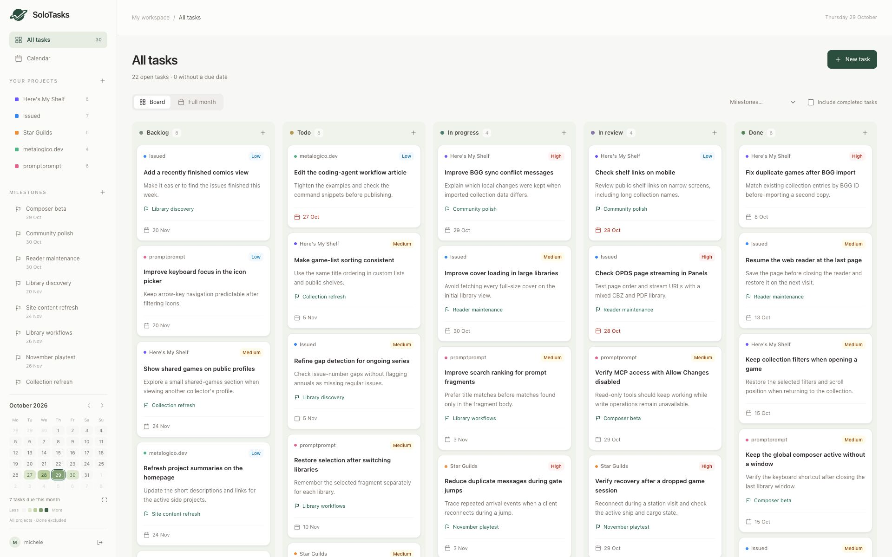
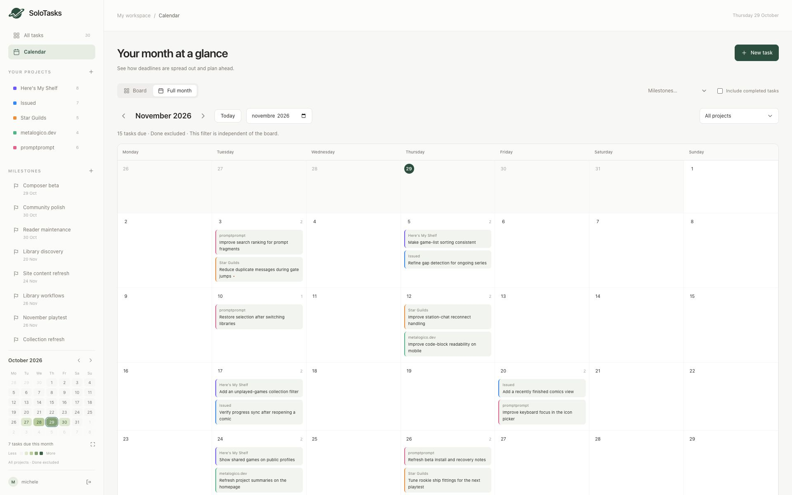

# SoloTasks

A self-hosted task manager for one person. Organize tasks on a Kanban board, group them by project and milestone, and see deadlines in a monthly calendar.

Built with Laravel, PHP 8.4, Vue 3, Tailwind CSS and SQLite. Runs in Docker.

[Website](https://solotasks.metalogico.dev) · [Installation](#installation) · [Backup and recovery](docs/operations.md)



*Actual application screenshots from the SoloTasks website, with demonstration data.*

## Features

- Five Kanban columns: Backlog, Todo, In progress, In review and Done.
- Move tasks by dragging a card or changing its column in the task form.
- Projects with colors, a separate board for each project and an overview of all tasks.
- Task descriptions, three priority levels, optional due dates and optional milestones.
- Milestones with their own deadlines, independent of task due dates.
- A compact calendar with a heatmap of daily deadlines, always visible alongside the board.
- A full monthly calendar with its own project filter, month navigation and direct month selection.
- A shared option to include completed tasks in both calendars.
- One personal login configured through environment variables, with no registration or user management.
- Persistent SQLite data and automatic, verified backups twice a day.
- English interface, locally bundled fonts and a layout that adapts to smaller screens.

<details>
<summary>Monthly calendar</summary>



</details>

## Installation

Docker downloads the prebuilt GHCR images for Linux AMD64 or ARM64. No Git, PHP, Python, Composer or Node installation is required on the server. Docker Compose 2.24.4 or newer is required.

The workflow publishes images when code reaches `main`. Wait for **Publish Docker images** to succeed and for the GHCR packages to be public before installing. `latest` follows main; `sha-<full commit>` selects a specific build.

Download the installation files from main. The archive also contains the source, but installation does not compile it:

```sh
mkdir solotasks
cd solotasks
curl -fL "https://github.com/metalogico/solotasks/archive/refs/heads/main.tar.gz" -o source.tar.gz
tar -xzf source.tar.gz --strip-components=1
```

For an existing installation, follow [the transition guide](docs/UPGRADING.md) instead of copying a new `.env`. Run the following commands in the extracted directory.

```sh
cp -n .env.example .env
chmod 600 .env
```

Keep an existing `.env` when updating. It contains your application key and personal login configuration.

### Download the image

```sh
docker compose pull
```

The app and scheduler use the same published image, `ghcr.io/metalogico/solotasks:latest`.

### Set the application key and login

Generate an application key:

```sh
docker compose run --rm --no-deps --entrypoint php app artisan key:generate --show --no-interaction
```

Copy the generated `base64:…` value into `APP_KEY` in `.env`. Generate a password hash interactively:

```sh
docker compose run --rm --no-deps --entrypoint php app artisan solotasks:password
```

Use at least 12 characters and no more than 72 bytes. Copy the complete `SOLOTASKS_PASSWORD_HASH='…'` line into `.env`, keeping its single quotes: they protect the dollar signs in the bcrypt hash from Compose interpolation. Set `SOLOTASKS_USERNAME` to your chosen username. Store the original password in your password manager.

The application does not provide a default password, registration or a password reset email.

### Start SoloTasks

```sh
docker compose config --quiet
docker compose up -d --wait
docker compose ps
```

Open [http://localhost:8092](http://localhost:8092) and sign in. A fresh installation starts empty. The entrypoint creates the database and applies migrations; it does not load demonstration data.

If startup fails, inspect `docker compose logs --tail=100 app scheduler`. Check that `APP_KEY`, the username and a valid bcrypt hash are configured.

### Network access and configuration

| Variable | Purpose | Default/example |
| --- | --- | --- |
| `APP_KEY` | Persistent Laravel application key | Generate before first start |
| `SOLOTASKS_USERNAME` | Personal login name | Choose your own |
| `SOLOTASKS_PASSWORD_HASH` | Bcrypt hash, enclosed in single quotes in `.env` | Generate with `solotasks:password` |
| `SOLOTASKS_BIND_IP` | Host interface exposed by Docker | `127.0.0.1` |
| `SOLOTASKS_PORT` | Host HTTP port | `8092` |
| `SOLOTASKS_URL` | Full URL used to reach the application | `http://localhost:8092` |
| `SESSION_SECURE_COOKIE` | Send session cookies only over HTTPS | `false` for local HTTP |
| `SOLOTASKS_CALENDAR_INCLUDE_DONE` | Initial completed-task setting | `false` |
| `SOLOTASKS_BACKUP_DIR` | Existing dedicated backup directory for the optional Compose override | See [operations](docs/operations.md#backups-on-another-disk) |

To allow LAN access, set `SOLOTASKS_BIND_IP` to the server's LAN address, or `0.0.0.0` to bind all interfaces. Set `SOLOTASKS_URL` to the matching address and port, then recreate the containers with `docker compose up -d --force-recreate --wait`.

The container serves HTTP on port 80. For HTTPS, put it behind your own reverse proxy and set `SOLOTASKS_URL` to the HTTPS URL and `SESSION_SECURE_COOKIE=true`. Keep the default localhost binding when the proxy runs on the host. Use a private network or VPN for remote personal access.

The application and backup schedule use `Europe/Rome`. The interface uses English dates with a Monday-first week; task and milestone dates are calendar dates without UTC conversion.

## Using SoloTasks

1. Create a project with the `+` button beside **Your projects**, or **Create your first project** on an empty board.
2. Add tasks with **New task** or a column's `+` button. New tasks default to medium priority and Backlog; adding from a column preselects that column.
3. Click a task's name to edit it. Drag cards between columns or change **Column** in the form. Cards are sorted by due date, then ID, with undated tasks last.
4. Select a project to filter the board and compact calendar. Click the compact calendar or **Full month** to open the monthly view. It starts on all projects and has an independent filter; returning to the board preserves the board's project selection.
5. Create and edit milestones from the sidebar or **Milestones…** menu. A milestone belongs to one project. Changing its date does not change task dates; deleting it keeps its tasks.

The heatmap counts tasks due on each date, with increasing intensity for 1, 2, 3–4 and 5 or more tasks. Completed tasks are excluded initially; **Include completed tasks** includes them in both calendars. Tasks without due dates stay on the board. A project can only be deleted after its tasks and milestones have been removed or moved.

## Data, backups and updates

Compose runs two services on a dedicated network:

| Service | Role | Memory limit |
| --- | --- | --- |
| `app` | Apache and PHP, plus database initialization and migrations | 512 MiB |
| `scheduler` | Scheduled SQLite backups; starts after the app is healthy | 128 MiB |

Both restart with `unless-stopped`. Only the app publishes a port.

| Volume | Container path | Contents |
| --- | --- | --- |
| `data` | `/var/lib/sh-solotasks` | `database.sqlite`, containing projects, milestones and tasks |
| `storage` | `/var/www/html/storage` | Sessions, cache, compiled views and application working files |
| `backups` | `/backups` | Verified SQLite snapshots |

The default Compose project name is `sh-solotasks`, so volumes are prefixed with `sh-solotasks_`. Rebuilding or recreating containers preserves them. **Do not use `docker compose down -v` on an installation whose data you want to keep.**

Backups run at **03:00 and 15:00 Europe/Rome**. They are retained until you remove them. A backup volume on the same disk does not protect against disk failure; export copies or use the external-directory override.

Before updating, create, verify and export a backup. Keep `.env`, the current image version and the same Compose project name. Follow [the upgrade guide](docs/UPGRADING.md), including stopping the scheduler before migrations. See [operations](docs/operations.md) for manual backups, restore and password changes.

## Development

The source uses Laravel 13 and Vue 3 with Vite and Tailwind CSS 4. Dependency versions are recorded in `composer.lock` and `package-lock.json`.

For local source work, install PHP 8.4 with the required extensions, Composer and Node.js 24, then run:

```sh
composer install
npm ci
npm test
php artisan test --compact
npm run build
```

The PHP tests use an in-memory SQLite database. Keep `APP_ENV=testing` and `DB_DATABASE=:memory:` as configured in `phpunit.xml`; do not point tests at an installation database. No test loads demo data into a running installation.

Format PHP with `vendor/bin/pint`. The Docker image contains production dependencies only; run development tests in the source checkout.

## License

[MIT](LICENSE). Copyright (c) 2026 Michele.

## Releases and source builds

See [RELEASING.md](docs/RELEASING.md) for local checks, GHCR publication and schema policy. For local Docker builds, use `docker compose -f compose.yaml -f compose.build.yaml up -d --build --wait` from a source checkout with a separate development environment and data. See the same guide before adding optional backup overrides to a source build.
