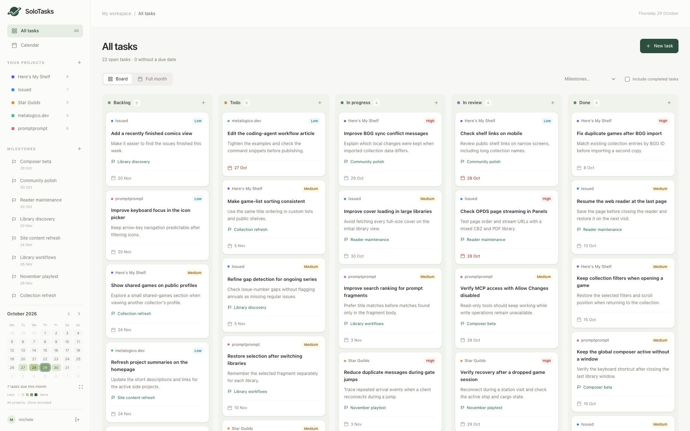
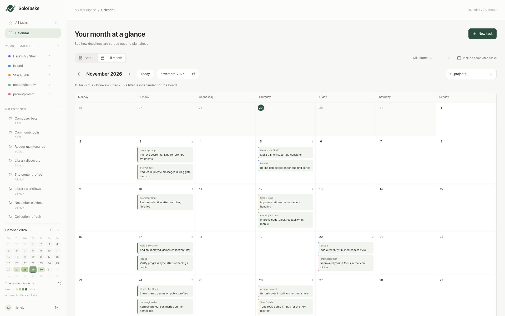

# SoloTasks

A self-hosted task manager for one person. Organize tasks on a Kanban board, group them by project and milestone, and see deadlines in a monthly calendar.

Built with Laravel, PHP 8.4, Vue 3, Tailwind CSS and SQLite. Runs in Docker.

[Website](https://solotasks.metalogico.dev) · [Installation](#installation) · [Operations](docs/operations.md)



## Features

- Five Kanban columns: Backlog, Todo, In progress, In review and Done.
- Move tasks by dragging a card or changing its column in the task form.
- Projects with colors, a separate board for each project and an overview of all tasks.
- Task descriptions, three priority levels, optional due dates and optional milestones.
- Assign tasks to Me or a generic AI Agent, with a shared assignment filter for the board and calendars.
- Connect AI agents through an optional authenticated MCP server to search and update tasks and milestones.
- Milestones with their own deadlines, independent of task due dates.
- A compact calendar with a heatmap of daily deadlines, always visible alongside the board.
- A full monthly calendar with its own project filter, month navigation and direct month selection.
- A shared option to include completed tasks in both calendars.
- One personal login configured through environment variables, with no registration or user management.
- Persistent SQLite data.
- English interface, locally bundled fonts and a layout that adapts to smaller screens.

<details>
<summary>Monthly calendar</summary>



</details>

## Installation

Docker image: **`ghcr.io/metalogico/solotasks:latest`**

Requires Docker with Compose 2.24.4 or newer. Images support `linux/amd64` and `linux/arm64`.

### Download the configuration

For a new installation:

```sh
mkdir solotasks
cd solotasks
curl -fL https://raw.githubusercontent.com/metalogico/solotasks/main/compose.yaml -o compose.yaml
curl -fL https://raw.githubusercontent.com/metalogico/solotasks/main/.env.example -o .env.example
cp .env.example .env
chmod 600 .env
```

Already installed? Keep your `.env` and follow [Updating](#data-and-updates).

Pull the image:

```sh
docker compose pull
```

### Set the application key and login

Generate an application key:

```sh
docker compose run --rm --no-deps --entrypoint php app artisan key:generate --show --no-interaction
```

Copy the generated `base64:…` value into `APP_KEY` in `.env`. Generate a password hash interactively:

```sh
docker compose run --rm --no-deps --entrypoint php app artisan solotasks:password
```

Use at least 12 characters and no more than 72 bytes. Copy the complete `SOLOTASKS_PASSWORD_HASH='…'` line into `.env`, keeping its single quotes: they protect the dollar signs in the bcrypt hash from Compose interpolation. Set `SOLOTASKS_USERNAME` to your chosen username. Store the original password in your password manager.

The application does not provide a default password, registration or a password reset email.

### Start SoloTasks

```sh
docker compose config --quiet
docker compose up -d --wait
docker compose ps
```

Open [http://localhost:8092](http://localhost:8092) and sign in. A fresh installation starts empty. The entrypoint creates the database and applies migrations; it does not load demonstration data.

If startup fails, inspect `docker compose logs --tail=100 app`. Check that `APP_KEY`, the username and a valid bcrypt hash are configured.

### Network access and configuration

| Variable | Purpose | Default/example |
| --- | --- | --- |
| `APP_KEY` | Persistent Laravel application key | Generate before first start |
| `SOLOTASKS_USERNAME` | Personal login name | Choose your own |
| `SOLOTASKS_PASSWORD_HASH` | Bcrypt hash, enclosed in single quotes in `.env` | Generate with `solotasks:password` |
| `SOLOTASKS_BIND_IP` | Host interface exposed by Docker | `127.0.0.1` |
| `SOLOTASKS_PORT` | Host HTTP port | `8092` |
| `SOLOTASKS_URL` | Full URL used to reach the application | `http://localhost:8092` |
| `SESSION_SECURE_COOKIE` | Send session cookies only over HTTPS | `false` for local HTTP |
| `SOLOTASKS_CALENDAR_INCLUDE_DONE` | Initial completed-task setting | `false` |
| `SOLOTASKS_MCP_TOKEN` | Optional MCP bearer token, also used by the client | Empty disables MCP access |

To allow LAN access, set `SOLOTASKS_BIND_IP` to the server's LAN address, or `0.0.0.0` to bind all interfaces. Set `SOLOTASKS_URL` to the matching address and port, then recreate the containers with `docker compose up -d --force-recreate --wait`.

The container serves HTTP on port 80. For HTTPS, put it behind your own reverse proxy and set `SOLOTASKS_URL` to the HTTPS URL and `SESSION_SECURE_COOKIE=true`. Keep the default localhost binding when the proxy runs on the host. Use a private network or VPN for remote personal access.

The application uses `Europe/Rome`. The interface uses English dates with a Monday-first week; task and milestone dates are calendar dates without UTC conversion.

## Using SoloTasks

1. Create a project with the `+` button beside **Your projects**, or **Create your first project** on an empty board.
2. Add tasks with **New task** or a column's `+` button. New tasks default to medium priority and Backlog; adding from a column preselects that column.
3. Click a task's name to edit it. Drag cards between columns or change **Column** in the form. Cards are sorted by due date, then ID, with undated tasks last.
4. Select a project to filter the board and compact calendar. Click the compact calendar or **Full month** to open the monthly view. It starts on all projects and has an independent filter; returning to the board preserves the board's project selection.
5. Create and edit milestones from the sidebar or **Milestones…** menu. A milestone belongs to one project. Changing its date does not change task dates; deleting it keeps its tasks.
6. Use **Assigned to** in the task form to choose **Me** or **Agent**. New tasks default to Me, including when the Agent filter is active. Agent represents an AI agent; assignment does not start an automated execution.

The **Assigned to: All / Me / Agent** filter applies to the board, compact calendar and full monthly calendar together, including their task counts and heatmap. It starts on All for each session. Project totals in the sidebar always include all assignees. The full calendar's project filter remains independent of the board.

The heatmap counts tasks due on each date, with increasing intensity for 1, 2, 3–4 and 5 or more tasks. Completed tasks are excluded initially; **Include completed tasks** includes them in both calendars. Tasks without due dates stay on the board. A project can only be deleted after its tasks and milestones have been removed or moved.

## MCP access for AI agents

SoloTasks provides an optional HTTP [Model Context Protocol](https://laravel.com/framework/docs/mcp) server at **`/mcp/solotasks`**. It uses a dedicated bearer token, independently of the browser login. Access is disabled until a token is configured.

Generate a token:

```sh
docker compose run --rm --no-deps --entrypoint php app artisan solotasks:mcp-token
```

Copy the displayed `SOLOTASKS_MCP_TOKEN=…` line into your private `.env` and use the same token value in your MCP client. Then recreate the app:

```sh
docker compose up -d --force-recreate --wait
```

Configure your client with the application URL followed by `/mcp/solotasks` and an `Authorization: Bearer <token>` header. For clients accepting an `mcpServers` configuration:

```json
{
  "mcpServers": {
    "solotasks": {
      "url": "http://localhost:8092/mcp/solotasks",
      "headers": {
        "Authorization": "Bearer <token>"
      }
    }
  }
}
```

Use the URL reachable from the agent's machine; its `localhost` may differ from the server's. See [Network access and configuration](#network-access-and-configuration) for remote access.

| Tool | Purpose |
| --- | --- |
| `get_context` | Current app date, timezone, Monday-to-Sunday week, allowed values and permissions |
| `list_projects` | Existing project names, IDs, colors and task counts |
| `list_tasks` | Task search with combinable filters |
| `get_task` | Full details of one task |
| `list_milestones` | Milestones, optionally filtered by project and due-date range |
| `create_task` | Add a task to an existing project and optional milestone |
| `update_task` | Edit a task, change status or assignee, or reschedule it |
| `create_milestone` | Add a milestone to an existing project |
| `update_milestone` | Edit a milestone's name or due date |

`list_tasks` accepts `project_id`, `milestone_id`, `assignee` (`me` or `agent`), `priorities` (an array of `high`, `medium`, `low`), `statuses` (an array of board status values), `search` (literal text in the name or description), `due_from`, `due_to`, `overdue` and `without_due_date`. Different filters combine with AND; multiple priorities or statuses match any supplied value. Both boolean flags apply their filter only when true. Completed tasks are included by default; `overdue=true` selects only unfinished tasks due before today. Undated tasks do not match date-range or overdue filters.

Date boundaries are inclusive `YYYY-MM-DD` calendar dates in the app timezone. The agent calls `get_context` to interpret requests such as “What must I do today?”, “What must you do today?” or “Show high-priority tasks this week in project X”. In the user's requests, **I/me** means the human (`me`), and **you/the agent** means `agent`. No fixed daily report is imposed: the agent combines filters for the question being asked.

All list tools accept `page` and `per_page` (default 50, maximum 100) and return `data` plus `pagination` with `page`, `per_page`, `total`, `last_page` and `next_page`. The agent must follow `next_page` to retrieve all results. Tasks are ordered by due date and ID, with undated tasks last.

The token allows reading all projects and reading, creating and updating both human and agent tasks and milestones. **It cannot create, edit or delete projects, delete tasks or milestones, or move an existing task between projects or milestones.** Task updates accept only `name`, `description`, `priority`, `status`, `assignee` and `due_date`; set `description` or `due_date` to `null` to clear it. Milestone updates accept only `name` and `due_date`, and cannot change their project or task dates. Unknown arguments are rejected. Assignment to an agent does not start automated work.

See [MCP token management](docs/operations.md#mcp-token-management) to rotate or disable access. Changing the browser login does not revoke the MCP token.

## Data and updates

Compose runs one service on a dedicated network:

| Service | Role | Memory limit |
| --- | --- | --- |
| `app` | Apache and PHP, plus database initialization and migrations | 512 MiB |

The app restarts with `unless-stopped` and publishes one HTTP port.

| Volume | Container path | Contents |
| --- | --- | --- |
| `data` | `/var/lib/sh-solotasks` | `database.sqlite`, containing projects, milestones and tasks |
| `storage` | `/var/www/html/storage` | Sessions, cache, compiled views and application working files |

The default Compose project name is `sh-solotasks`, so volumes are prefixed with `sh-solotasks_`. Recreating containers preserves them. **Do not use `docker compose down -v` on an installation whose data you want to keep.**

Before updating, back up both volumes and your `.env` using your backup tools, and retain the current image tag or digest. See [operations](docs/operations.md) for data recovery and password changes.

```sh
docker compose pull
docker compose stop
docker compose up -d --wait --remove-orphans
```

Keep the same `.env`, Compose project, data and override files. If you pinned an image version, change its reference in `.env` before pulling. See [Updates and rollback](docs/operations.md#updates-and-rollback) for recovery instructions.

## License

[MIT](LICENSE). Copyright (c) 2026 metalogico.
